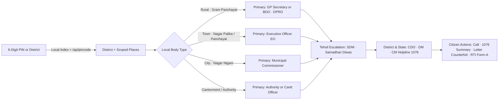

<div align="center">

# UP Civic Grievance Portal · उत्तर प्रदेश जनहित समाधान

**Know who to complain to · शिकायत किससे करें, यहाँ जानें**

An independent, bilingual (`English` / `हिन्दी`), mobile-first public grievance & escalation guide for residents of **Uttar Pradesh**—mapping **6-digit PIN codes**, **119,000+ LGD villages & urban bodies**, and **75 district directories** directly to verified officer phone numbers, **SDM / Tehsil Samadhan Diwas** escalation ladders, formal petitions, and **RTI Form-A** drafts.

[](https://up-civic-redressal.vercel.app/)
[](https://nextjs.org/)
[](https://www.typescriptlang.org/)
[](https://up-civic-redressal.vercel.app/directory/)

[Overview](#overview) • [How Routing Works](#how-routing-works) • [Escalation Matrix](#jurisdiction--escalation-matrix) • [Dataset & Guardrails](#dataset-coverage--integrity-guardrails) • [Routes & API](#routes--api-reference) • [Local Setup](#local-development--verification)

</div>

---

> **Public Information Disclaimer:** This platform is an independent civic utility maintained in the public interest. It is **not** affiliated with, endorsed by, or operated by the Government of Uttar Pradesh. Officer contacts and portal links are compiled strictly from official `.gov.in` and `.nic.in` sources; please confirm critical details on official government websites.

---

## Overview

When a handpump stops working, a drain overflows, a street light stays dark, or MGNREGA wages stall, citizens in Uttar Pradesh typically know whom they voted for—not which administrative office controls the sanctioning budget, what statutory escalation applies, or whom to appeal to if local action stalls.

**UP Civic Grievance Portal** turns raw location signals into clear, actionable steps in under a minute:

| Citizen Need | How the Portal Helps |
| --- | --- |
| **Find the exact first officer** | Enter a **6-digit UP PIN code** or select District → Block/Village/Town to resolve Rural (**GP / BDO / SDM / CDO / DM**), Town (**EO / SDM / DM**), Nagar Nigam (**Municipal Commissioner / SDM / DM**), or Authority (**NOIDA / GNIDA / YEIDA / Cantonment**) officers. |
| **Act on 6 common civic issues** | Guided flows (`/issue/[slug]/`) for **Street Light**, **Drain & Waterlogging**, **Damaged Road**, **Handpump & Drinking Water**, **MGNREGA**, and **Garbage**—complete with live primary contacts and matched UP portals (`1076`, `1533`, `1800-121-2164`). |
| **Escalate when nothing happens** | Every rural, urban, and authority ladder surfaces clear step-up channels including **Sub-Divisional Magistrate (SDM) / Tehsil Samadhan Diwas (1st & 3rd Tuesday)** and District Magistrate (`DM`). |
| **File online, call 1076, or submit offline** | Generate a bilingual **30-second 1076 / Jansunwai summary**, print-ready **UP Janhit Guarantee Act 2011** complaint letter (with office copy counterfoil & optional CC to SDM/CDO/DM), or **RTI Act 2005 Form-A**—100% inside your browser. |

---

## How Routing Works



---

## Jurisdiction & Escalation Matrix

All 6 issue flows dynamically adapt their escalation steps (`lib/issue-routing.ts`, `lib/resolver.ts`, `public/data/issues/*.json`) based on the citizen's selected locality:

| Area Classification | Issue Category | Step 01 (First Contact) | Escalation Path | Matched Official Portals |
| --- | --- | --- | --- | --- |
| **Rural Gram Panchayat** | Street Light | GP Secretary / BDO | `BDO → SDM → DM` | Panchayati Raj UP, Jansunwai, `1076` |
| **Rural Gram Panchayat** | Drain / Garbage / Handpump | GP Secretary / BDO | `(ADO / DPRO) → SDM → DM` | Jal Samadhan (`1800-121-2164`), Panchayati Raj UP |
| **Rural Gram Panchayat** | Road Construction | GP Secretary / BDO | `BDO → SDM → CDO → DM` | Panchayati Raj UP, `rtionline.up.gov.in` |
| **Rural Gram Panchayat** | MGNREGA Work / Wages | GP Secretary / BDO (Form-6) | `BDO → SDM → CDO → DM` | `nrega.nic.in`, Jansunwai, `1076` |
| **Nagar Panchayat / Palika** | Civic Issues *(non-MGNREGA)* | Executive Officer (`EO`) | `EO → SDM → DM` | e-NagarSewa (`1533`), Jansunwai, `1076` |
| **Nagar Nigam (17 Cities)** | Civic Issues *(non-MGNREGA)* | Municipal Commissioner | `Commissioner → SDM → DM` | e-NagarSewa (`1533`), Jansunwai, `1076` |
| **NOIDA / GNIDA / YEIDA / Cantt** | Civic Issues *(non-MGNREGA)* | Authority / Cantt Office | `Officer → SDM → DM` | e-NagarSewa (`1533`), Jansunwai, `1076` |

> **Honest Urban MGNREGA Safeguard:** Selecting MGNREGA inside an urban ward, Nagar Nigam, or Industrial Development Authority surfaces an explicit notice routing rural work requests back to a Gram Panchayat / Block instead of showing misleading municipal numbers.

---

## Dataset Coverage & Integrity Guardrails

The repository pairs **119,211 indexed places** (`107,486` LGD village records across `114,724` village entries, `860` block entries, `3,627` towns/wards) and **1,658 UP PIN codes** across all **75 districts** with automated quality enforcement in [`scripts/validate-data.ts`](scripts/validate-data.ts):

- **Published Official Contacts Only:** Directly indexed verified phones cover **75/75 DMs**, **74/75 CDOs**, **290/351 SDMs** (`0` districts missing SDM coverage), **460/860 BDOs**, **211/283 EOs**, **17/17 Nagar Nigam Commissioners**, and **24/75 DPROs**.
- **Zero Synthetic Placeholders:** Validation fails on synthetic placeholder emails, glued phone+email prefixes, non-civic district officials (`DIOS`/`DIO`), KrutiDev `0`-dot artifacts, mixed English/Devanagari scripts, or unverified 4-digit metro STD splits (`0120-`, `0522-`, `0542-`, `0551-`, etc.).
- **No Fabricated SLAs:** `time_limit_days` is rendered only when backed by an explicit statutory `time_limit_source_url`; otherwise the UI transparently states *"Official time limit: not confirmed"*.
- **Graceful Rural Secretary Disclosure:** Because Uttar Pradesh district portals do not publish individual Gram Panchayat Secretary CUG directories centrally (`secretaryNotIndexed`), rural lookups highlight the verified **Block Development Officer (BDO)** first alongside a transparent Gram Panchayat filing note instead of emitting fake "vacant post" alerts.
- **Privacy-Preserving Feedback:** [`app/api/feedback/route.ts`](app/api/feedback/route.ts) and [`app/api/report/route.ts`](app/api/report/route.ts) hash caller IPs using `SHA-256(ip + DAILY_SALT)` with sliding per-hour rate limits (`10/hr` feedback, `5/hr` error reports) and never accept or store citizen complaint letters.

---

## Routes & API Reference

| Route / Endpoint | Purpose |
| --- | --- |
| `/` | Editorial entry page with Quick 6-digit PIN lookup, Saved Area resume bar, and 6-issue launchers |
| `/find/` | 3-step location-first wizard (`PIN/District + Area Type → Village/Block/Town → Officers & 1076 Summary`) |
| `/issue/[slug]/` | Issue-specific action panel, live officer matching, statutory ladder, and document checklist |
| `/letter/` | UP Janhit Guarantee Act 2011 petition generator, CC checkboxes (SDM/CDO/DM), copy text & `@media print` counterfoil |
| `/rti/` | RTI Act 2005 Form-A draft generator with issue-specific record templates & `rtionline.up.gov.in` link |
| `/directory/` & `/directory/[district]/` | Searchable 75-district officer directories with HQ/SDM/Block/ULB filter pills & freshness badges |
| `/about/` & `/report/` | Data methodology disclaimer, official portal directory, and wrong-number reporting form |
| `GET /api/pincode?pin=226301` | Local India Post UP index lookup with prefix matching and live Postal PIN API fallback |
| `POST /api/feedback` | Rate-limited (`10/hr`) *"Did this number work?"* tally endpoint (`204 No Content`) |
| `POST /api/report` | Rate-limited (`5/hr`) wrong/outdated office number report endpoint (`204 No Content`) |

---

## Tech Stack & Project Structure

- **Core:** Next.js `15.5` (App Router on **Vercel** via [`vercel.json`](vercel.json)), React `19`, TypeScript `5.7`
- **Design System & Typography:** [`@astryxdesign/core`](https://www.npmjs.com/package/@astryxdesign/core) (`@stylexjs/stylex`), Tailwind CSS, custom `nl-classic` theme tokens ([`themes/nl-classic/`](themes/nl-classic)), self-hosted `Source Serif 4`, `Inter`, `Noto Serif Devanagari`, and `Noto Sans Devanagari`
- **Testing & Data Pipelines:** Zod schemas ([`lib/validate.ts`](lib/validate.ts)), Vitest unit/route tests ([`tests/`](tests)), Playwright Chromium + Mobile Chrome E2E tests ([`tests/e2e/flows.spec.ts`](tests/e2e/flows.spec.ts)), PDF/KrutiDev parser & transliteration pipeline ([`scripts/`](scripts))

```text
up-civic-grievance/
├── app/                  Next.js App Router pages & serverless /api/* route handlers
├── components/           Shared UI modules (SearchSelect, OfficerCard, LadderStep, Stepper, PrintSheet)
├── lib/                  Jurisdiction resolver, issue routing, PIN resolution, i18n, saved area & Zod schemas
├── locales/              English (en.json) and Hindi (hi.json) translations with 100% key-parity tests
├── public/data/          75 district officer JSONs, 75 LGD/ULB place datasets, state portals, issues & PIN index
├── scripts/              Directory harvesters, PDF KrutiDev/phone parser, transliteration & strict validator
├── tests/                Vitest unit/API suites and Playwright Desktop & Mobile E2E tests
├── themes/               Compiled Astryx design theme (nl-classic)
└── DECISIONS.md          Architectural decisions & data verification policies
```

---

## Local Development & Verification

### Prerequisites
- **Node.js `>= 22.13.0`** and **npm**

### Quick Start

```bash
git clone https://github.com/prash00000/UP-CIVIC-REDRESSAL.git
cd UP-CIVIC-REDRESSAL
npm install
npm run dev
```

Open [http://localhost:3000](http://localhost:3000) in your browser.

### Verification Suite

```bash
npx tsc --noEmit         # Static TypeScript type checking
npm run validate-data    # Strict Zod + script/phone/LGD integrity check across all 75 districts
npm test                 # Vitest unit, routing, transliteration, i18n parity & /api/* tests
npm run build            # Production Next.js build (96 static/SSG routes + serverless API routes)
npm run test:e2e         # Playwright E2E tests across Desktop Chrome & Mobile Chrome
```

### Optional Environment Variables

| Variable | Purpose | Default / Behavior |
| --- | --- | --- |
| `NEXT_PUBLIC_SITE_URL` | Canonical origin for `sitemap.xml` | `https://up-civic-redressal.vercel.app` |
| `DAILY_SALT` | Daily salt for SHA-256 IP rate-limit hashing | Current UTC date (`YYYY-MM-DD`) |
| `SUPABASE_URL` | Supabase project URL for feedback/error reports | Optional; uses in-memory `204` handling when unset |
| `SUPABASE_SERVICE_ROLE_KEY` | Supabase service key for inserting `number_feedback` / `error_reports` | Optional |
| `ONLY_DISTRICT` / `CLEAN_ONLY` / `UPDATE_INDEX` | Targeted flags when running `scripts/harvest-directory.ts` | Unset (full run when omitted) |
